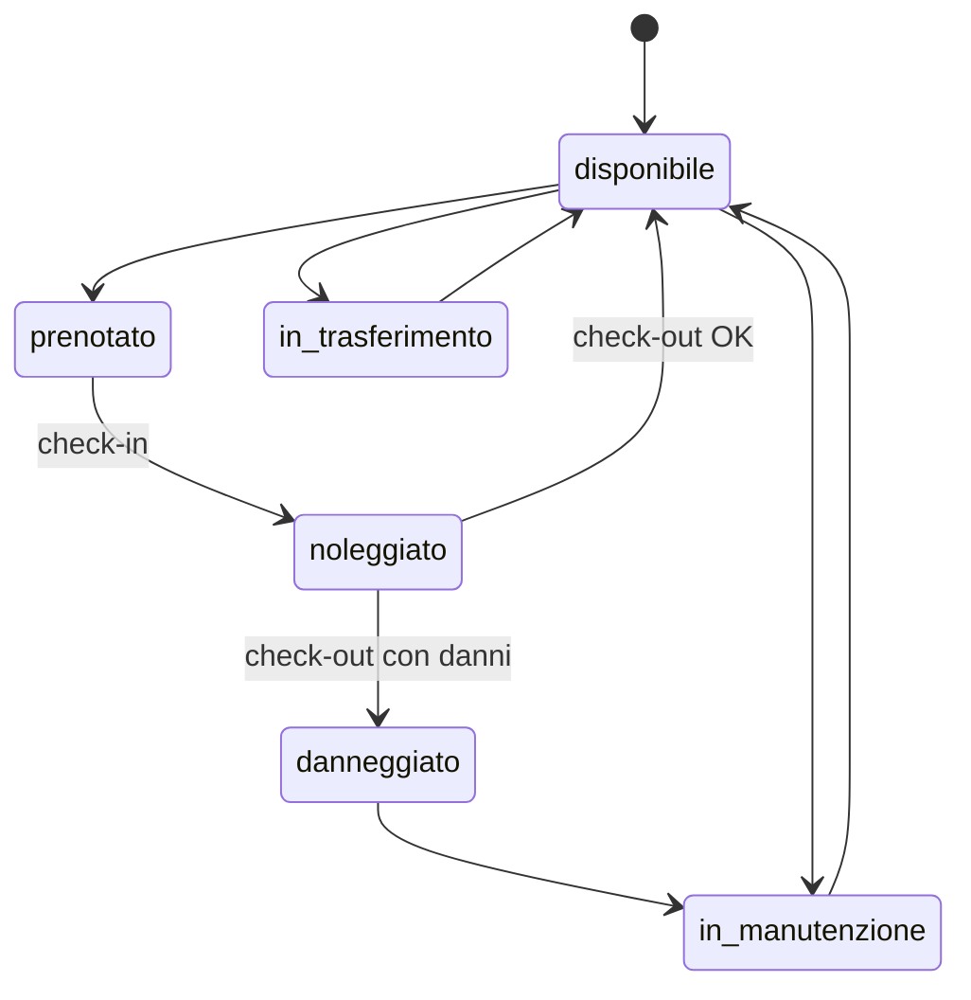
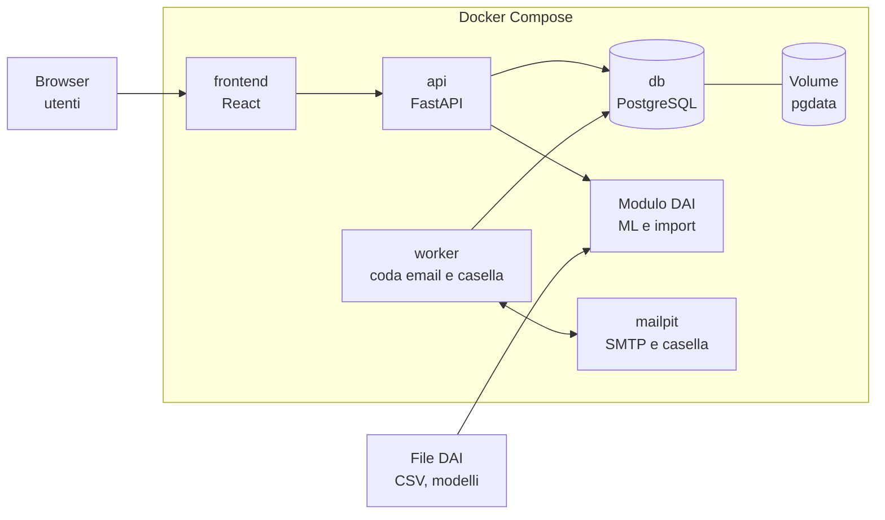
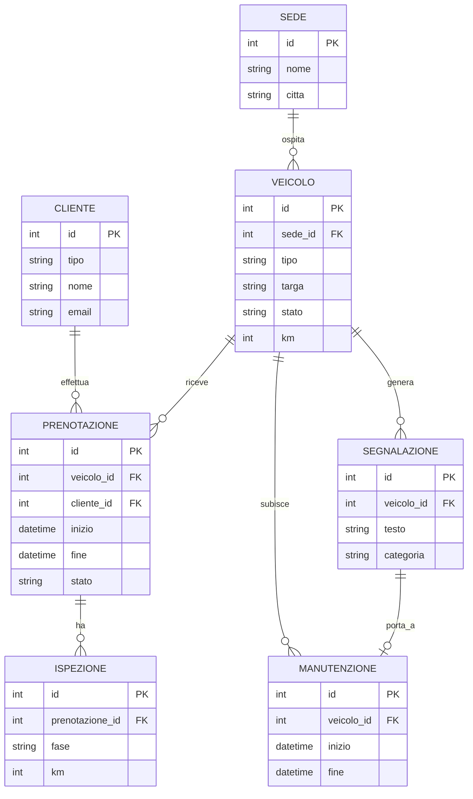
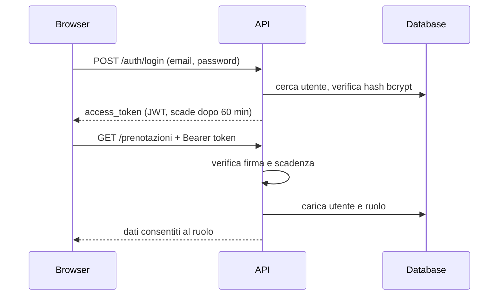
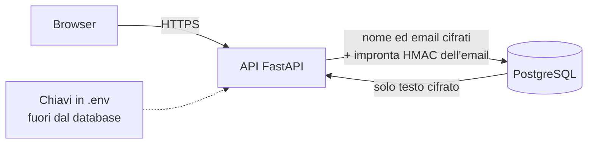
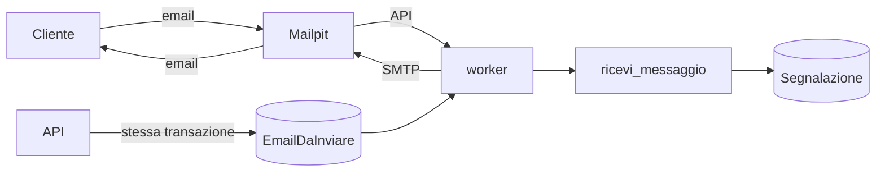

# Buby Rent – Documentazione tecnica (ruolo WSA)

Progetto Laboratorio Integrato · ITS Academy ICT Piemonte · Caso 3: Trasporti con noleggi

Applicazione web per prenotare e gestire il noleggio di auto, furgoni ed e-bike su più sedi, con un'area operatore per flotta, manutenzioni e trasferimenti. Usa i dati preparati dal team Data Analyst e AI Specialist (DAI) e ospita le loro componenti: previsione della domanda per sede e classificazione di danni e richieste di assistenza.

## Indice

1. [Scadenze](#1-scadenze)
2. [Come funziona un noleggio](#2-come-funziona-un-noleggio)
3. [Utenti e requisiti](#3-utenti-e-requisiti)
4. [Architettura](#4-architettura)
5. [Modello dati](#5-modello-dati)
6. [Logica di disponibilità](#6-logica-di-disponibilità)
7. [Autenticazione e autorizzazione](#7-autenticazione-e-autorizzazione)
8. [Protezione dei dati e GDPR](#8-protezione-dei-dati-e-gdpr)
9. [Email e comunicazioni](#9-email-e-comunicazioni)
10. [API REST](#10-api-rest)
11. [Struttura del repository](#11-struttura-del-repository)
12. [Installazione e avvio](#12-installazione-e-avvio)
13. [Stato attuale e da fare](#13-stato-attuale-e-da-fare)
14. [Piano di lavoro](#14-piano-di-lavoro)
15. [Consegne e valutazione](#15-consegne-e-valutazione)
16. [Rischi e attenzioni](#16-rischi-e-attenzioni)

---

## 1. Scadenze

| Data | Evento |
| --- | --- |
| 26 ottobre 2026 | Kickoff con il cliente: requisiti e formazione dei team |
| Seconda settimana | Definizione del contratto dati con il team DAI (sviluppo con dati mock) |
| 20 novembre 2026 | SAL 1: analisi, schema dati e contratto API. Schema e contratto vengono congelati |
| Settimane finali | Integrazione con i dati reali, test e rilascio |
| 18 dicembre 2026 | Presentazione finale al cliente |

Ogni settimana i team leader inviano al cliente un breve stato scritto.

## 2. Come funziona un noleggio

Un noleggio ruota attorno a un veicolo che passa da uno stato all'altro. Il backend deve modellare questo ciclo.

1. **Ricerca**: il cliente sceglie sede, date e tipo di veicolo e vede solo i mezzi liberi nel periodo.
2. **Prenotazione**: preventivo (tariffa, extra, cauzione) e conferma.
3. **Ritiro (check-in)**: verifica di documenti e patente, contratto, registrazione di km, carburante o batteria e foto dello stato del mezzo.
4. **Noleggio in corso**: eventuali proroghe o segnalazioni di problemi.
5. **Riconsegna (check-out)**: nuovo controllo, km percorsi, danni, ritardi e penali. Il confronto con le foto del ritiro stabilisce le responsabilità.
6. **Chiusura**: fatturazione e restituzione della cauzione.
7. **Post-noleggio**: pulizia e, se serve, manutenzione. Il veicolo torna disponibile solo quando è di nuovo idoneo.

**Stati del veicolo**: `disponibile`, `prenotato`, `noleggiato`, `in_manutenzione`, `danneggiato`, `in_trasferimento`. Il trasferimento tra sedi è un punto chiave del caso, perché la flotta non è sempre dove serve.

**Stati della prenotazione**: `richiesta`, `confermata`, `in_corso`, `conclusa`, `annullata`.



## 3. Utenti e requisiti

**Ruoli**

- **Cliente** (privato o azienda): cerca, prenota, consulta i propri noleggi, segnala un problema.
- **Operatore di sede**: gestisce flotta, check-in e check-out, manutenzioni e trasferimenti della propria sede.
- **Admin**: vede tutte le sedi, gestisce utenti, tariffe e sedi.

**Area cliente**

- Ricerca per sede, date e tipo di veicolo, con soli mezzi disponibili.
- Preventivo e conferma della prenotazione.
- Elenco dei propri noleggi, con annullamento e proroga.
- Segnalazione di guasti o danni in testo libero.

**Area operatore**

- Calendario e stato della flotta per sede.
- Check-in e check-out con km, carburante o batteria e foto.
- Gestione di segnalazioni, manutenzioni e fermi.
- Trasferimenti di veicoli tra sedi.
- Dashboard con utilizzo della flotta, previsione di domanda e giorni di fermo.

## 4. Architettura

Stack scelto: **Python con FastAPI**, **PostgreSQL**, **Docker Compose**. Il backend è unico e in un solo linguaggio, così condivide codice e librerie con le componenti Python del team DAI. k3s non è usato: risolve problemi di scala e alta disponibilità che il progetto non ha, e si può citare come evoluzione futura.



| Servizio | Tecnologia | Porta | Note |
| --- | --- | --- | --- |
| `frontend` | React (oggi un segnaposto servito da nginx) | 3000 | Dashboard, ricerca, prenotazioni, area operatore |
| `api` | FastAPI | 8000 | Documentazione OpenAPI su `/docs` |
| `worker` | Python (stessa immagine dell'`api`) | – | Spedisce le email in coda e legge la casella di assistenza (sezione 9) |
| `mailpit` | Mailpit | 8025 (web e API), 1025 (SMTP) | Server SMTP finto con casella e interfaccia web, per sviluppo e demo |
| `db` | PostgreSQL 16 | 5432 (interna) | Dati su volume persistente `pgdata` |
| Modulo DAI | Python, dentro `api` o servizio separato | – | Previsioni e classificazione; i file di output del team DAI vengono importati |

## 5. Modello dati



Implementate nel codice: `Sede`, `Veicolo`, `Cliente` (nome ed email cifrati, `email_idx`, `anonimizzato_il`), `Prenotazione`, `Segnalazione` (mittente, oggetto, testo e sintesi cifrati; categoria, urgenza e targa estratta compilati dal team DAI; collegata a veicolo, prenotazione e cliente quando noti; con `canale`, `sede_id`, `assegnata_a`, `message_id` e `in_reply_to`), `NotaInterna` (testo cifrato, mai visibile al cliente), `EmailDaInviare` (coda in uscita, campi cifrati), `Utente` (email cifrata, `email_idx`, password_hash, ruolo, collegamento opzionale a `Cliente` e a `Sede`, `privacy_versione`, `privacy_accettata_il`). Utente e i campi di protezione dati non sono nel diagramma per semplicità; la cifratura è descritta nella sezione 8. Previste ma non ancora implementate: `Ispezione`, `Manutenzione`, `Trasferimento`, `Tariffa`, `Contratto`. I campi delle tabelle di previsione e classificazione del team DAI si decidono nel contratto dati.

## 6. Logica di disponibilità

Un veicolo è prenotabile in un periodo solo se:

- il suo stato non è `in_manutenzione`, `danneggiato` o `in_trasferimento`;
- non ha prenotazioni attive (`richiesta`, `confermata`, `in_corso`) che si sovrappongono al periodo.

Due periodi A e B si sovrappongono quando `inizio_A < fine_B` e `fine_A > inizio_B`.

Per evitare doppie prenotazioni simultanee, `POST /prenotazioni` blocca la riga del veicolo (`SELECT ... FOR UPDATE`) all'interno della transazione: due richieste sullo stesso mezzo si accodano e la seconda trova la sovrapposizione e riceve `409`.

Le manutenzioni e i trasferimenti pianificati dovranno entrare nello stesso controllo quando le rispettive tabelle saranno implementate.

## 7. Autenticazione e autorizzazione

L'API usa token **JWT** (JSON Web Token) firmati con HS256. Il cliente fa login una volta, riceve un token e lo invia in ogni richiesta protetta nell'header `Authorization: Bearer <token>`.



**Password**: salvate solo come hash bcrypt, mai in chiaro. Lunghezza minima 8 caratteri, massima 72 (limite di bcrypt).

**Token**: contiene `sub` (id utente), `ruolo`, `iat` e `exp`. Viene rifiutato con `401` se scaduto, alterato, firmato con un'altra chiave o malformato. Durata configurabile con `ACCESS_TOKEN_MINUTES` (default 60).

**Ruolo**: il ruolo che conta viene letto dal database a ogni richiesta, non dal token. Se un utente cambia ruolo o viene eliminato, l'effetto è immediato.

**Login**: le credenziali errate e l'email inesistente danno la stessa risposta `401`, e il tempo di risposta è simile, per non rivelare quali email sono registrate.

**Registrazione**: `POST /auth/register` crea sempre un utente con ruolo `cliente` (e la relativa anagrafica `Cliente`). Richiede `accetta_privacy: true`: versione dell'informativa e data di accettazione vengono salvate. Se esiste già un'anagrafica importata dal dataset con la stessa email e senza account, il nuovo account viene collegato a quella, così il cliente ritrova le sue prenotazioni e segnalazioni. Senza verifica dell'email è un'ipotesi accettabile solo in demo: è controllata dal flag `COLLEGA_CLIENTI_IMPORTATI`, attivo in sviluppo e spento di default con `ENVIRONMENT=production`. Operatori e admin non si auto-registrano: vengono creati dall'amministratore, oggi dal seed con le password prese da variabili d'ambiente.

**Permessi per ruolo**

| Azione | Pubblico | Cliente | Operatore | Admin |
| --- | --- | --- | --- | --- |
| Cercare veicoli disponibili | sì | sì | sì | sì |
| Registrarsi, fare login | sì | sì | sì | sì |
| Creare una prenotazione | no | solo per sé | per qualsiasi cliente | per qualsiasi cliente |
| Vedere le prenotazioni | no | solo le proprie | tutte | tutte |
| Cambiare lo stato di un veicolo | no | no | solo della propria sede | tutti |
| Creare una segnalazione | no | sì, a proprio nome | sì | sì |
| Vedere le segnalazioni | no | solo le proprie | quelle della propria sede e quelle non ancora smistate | tutte |
| Aggiornare stato, categoria, urgenza e assegnatario di una segnalazione | no | no | sì, entro i propri permessi di visibilità | sì |
| Leggere e scrivere note interne | no | no | sì, sulle segnalazioni che vede | sì |

**Nel codice**: `utente_corrente` (in `deps.py`) valida il token e restituisce l'utente; `richiedi_ruoli("operatore", "admin")` protegge un endpoint per ruolo. Esempio:

```python
@router.patch("/{veicolo_id}/stato")
def cambia_stato(..., utente: Utente = Depends(richiedi_ruoli("operatore", "admin"))):
    ...
```

**Configurazione** (file `.env`):

| Variabile | Uso |
| --- | --- |
| `SECRET_KEY` | Chiave di firma dei token. Genera: `python -c "import secrets; print(secrets.token_hex(32))"` |
| `ACCESS_TOKEN_MINUTES` | Durata del token (default 60) |
| `ENVIRONMENT` | `development` o `production`. In `production` le chiavi di sviluppo bloccano l'avvio |
| `ENCRYPTION_KEYS` | Chiavi di cifratura dei dati personali (vedi sezione 8) |
| `BLIND_INDEX_KEY` | Chiave dell'impronta per cercare l'email (vedi sezione 8) |
| `COLLEGA_CLIENTI_IMPORTATI` | `true` o `false`: collega la registrazione all'anagrafica importata con la stessa email. Default `true` in sviluppo, `false` in produzione |
| `ADMIN_EMAIL`, `ADMIN_PASSWORD` | Admin di prova creato al primo avvio |
| `OPERATORE_PASSWORD` | Password dell'operatore di prova (`operatore@buby.it`, sede 1) |

**Limiti attuali**: non c'è refresh token (alla scadenza l'utente rifà il login), né logout lato server, né blocco dopo tentativi falliti. Per il frontend, conservare il token in memoria è più sicuro che in `localStorage`.

## 8. Protezione dei dati e GDPR

> Questa sezione descrive le misure tecniche implementate e una checklist di lavoro. Non è consulenza legale: basi giuridiche, informativa, periodi di conservazione e ruoli (titolare, responsabile) vanno concordati con il referente privacy di Buby Group. I dati del laboratorio sono sintetici, quindi il GDPR non si applica al dataset; restano personali le email vere che un utente inserisce registrandosi alla demo. Le misure qui sotto sono implementate perché l'applicazione sia pronta per dati reali, e il documento di progetto chiede di curare anonimizzazione e GDPR. Le voci puramente organizzative della checklist 8.4 (registro dei trattamenti, procedura per le violazioni, informativa) sono indicate come necessarie in produzione, non vanno prodotte per la demo.

### 8.1 Cosa è protetto e come

| Dato | Misura | Note |
| --- | --- | --- |
| Password | Hash bcrypt | Non è cifratura: non si può risalire alla password |
| Nome ed email del cliente | Cifrati nel database (Fernet: AES-128-CBC con firma HMAC-SHA256) | Cifratura a livello applicativo: chi legge il database o un backup vede solo testo cifrato |
| Email di login (utenti) | Cifrata, più impronta HMAC-SHA256 | L'impronta (blind index) permette login e controllo dei duplicati senza salvare l'email in chiaro |
| Mittente, oggetto, testo e sintesi delle segnalazioni | Cifrati nel database | Categoria, urgenza, stato, date e collegamenti restano in chiaro per filtrare nella dashboard |
| Email in coda e log dell'invio | Destinatario, oggetto e corpo cifrati | Il corpo viene rimosso dopo l'invio |
| Note interne | Testo cifrato | Svuotate quando l'interessato cancella l'account |
| Dati in transito | HTTPS | Da configurare con un reverse proxy; su HTTP i dati viaggiano in chiaro |
| Disco, volume e backup del database | Cifratura a livello di infrastruttura | Fuori dal codice: da attivare dove si fa il deploy |
| Targa, km, date e stato delle prenotazioni | Non cifrati | Servono alle query (per esempio le sovrapposizioni). Restano personali solo tramite `cliente_id`, che senza nome ed email non identifica nessuno da solo |



**Come funziona nel codice**

- `crypto.py`: cifra e decifra con Fernet e calcola l'impronta HMAC.
- `encrypted_types.py`: il tipo di colonna `StringaCifrata` cifra in scrittura e decifra in lettura, quindi il resto del codice usa `cliente.nome` e `cliente.email` come testo normale.
- `models.py`: ogni volta che si assegna l'email, l'impronta `email_idx` viene ricalcolata in automatico. L'unicità e le ricerche usano `email_idx`, non l'email.

**Limiti della cifratura**

- Protegge da fughe del database e dei backup, non da un'applicazione compromessa: l'API possiede le chiavi.
- Non sostituisce il controllo degli accessi (sezione 7).
- I campi cifrati non si possono cercare per parte di testo né ordinare: l'email si trova solo con corrispondenza esatta, il nome non si cerca nel database.
- Se si perdono le chiavi, i dati sono irrecuperabili.

### 8.2 Gestione delle chiavi

| Chiave | Uso | Se viene esposta |
| --- | --- | --- |
| `ENCRYPTION_KEYS` | Cifra e decifra nomi ed email | Chi ha anche il database legge i dati personali |
| `BLIND_INDEX_KEY` | Impronta delle email | Si possono verificare elenchi di email candidate |
| `SECRET_KEY` | Firma dei token JWT | Si possono falsificare i token |

Regole:

- Le tre chiavi sono diverse tra loro, generate con i comandi in `.env.example`, e stanno solo in `.env` o in un gestore di segreti, mai nel repository né nei log.
- Va fatto un **backup separato** delle chiavi, non insieme al backup del database.
- Con `ENVIRONMENT=production` l'API non parte se usa le chiavi di sviluppo.
- In un deploy reale conviene un gestore di segreti (per esempio quello del cloud scelto) al posto del file `.env`.
- Cambiare `BLIND_INDEX_KEY` invalida tutte le impronte: dopo il cambio vanno ricalcolate, altrimenti nessuno riesce più a fare login. Va quindi scelta una volta e non ruotata alla leggera.

**Rotazione di `ENCRYPTION_KEYS`** (la prima chiave cifra, tutte decifrano):

1. Genera una nuova chiave Fernet.
2. Mettila prima delle altre: `ENCRYPTION_KEYS=NUOVA,VECCHIA`, poi riavvia l'API.
3. Esegui `docker compose exec api python -m app.rotate_keys`: ricifra tutte le righe con la chiave nuova.
4. Togli la chiave vecchia da `ENCRYPTION_KEYS`.

### 8.3 Diritti degli interessati

| Diritto | Articolo GDPR | Endpoint | Comportamento |
| --- | --- | --- | --- |
| Accesso e portabilità | 15 e 20 | `GET /auth/me/dati` | Tutti i dati dell'utente in JSON: account, anagrafica, prenotazioni, segnalazioni, versione dell'informativa accettata |
| Rettifica | 16 | `PATCH /auth/me` | Il cliente corregge il proprio nome |
| Cancellazione | 17 | `DELETE /auth/me` | Elimina l'account e anonimizza l'anagrafica; vedi sotto |

**Come funziona la cancellazione**: l'account viene eliminato, il nome diventa "Utente eliminato" e l'email diventa un valore anonimo (`eliminato-<id>@anonimo.invalid`). Il testo delle segnalazioni collegate (mittente, oggetto, testo, sintesi) viene rimosso, perché non c'è obbligo di conservarlo; restano categoria e urgenza; vengono svuotate anche le note interne e le email in coda o nel log dell'invio. L'export non include le note interne scritte dagli operatori: se vadano comunicate all'interessato va deciso con il referente privacy. Le segnalazioni importate da email non associate a nessun cliente non sono collegate a un account e quindi non vengono toccate. Le prenotazioni restano, ormai senza dati identificativi, perché contratti e fatture vanno conservati per obblighi di legge: l'art. 17, par. 3, lett. b) esclude la cancellazione quando il trattamento serve a adempiere un obbligo legale. Per le scritture contabili il periodo tipico in Italia è di 10 anni, da confermare con il cliente. Se il cliente ha prenotazioni attive la richiesta è rifiutata (`409`). Dopo la cancellazione l'email si può registrare di nuovo.

**Consenso e informativa**: per un noleggio la base giuridica del trattamento è di norma l'esecuzione del contratto, non il consenso. La registrazione richiede comunque di accettare l'informativa privacy e salva `privacy_versione` e `privacy_accettata_il`, come prova di quale testo l'utente ha visto. Il testo dell'informativa (art. 13) va fornito dal cliente e mostrato nel frontend.

### 8.4 Checklist di conformità

| Principio o obbligo | Stato | Cosa resta da fare |
| --- | --- | --- |
| Minimizzazione (art. 5): raccogliere solo il necessario | Fatto per ora | Raccolti nome, email e tipo cliente. Per patente e documenti, valutare se serve davvero conservarli dopo il ritiro |
| Cifratura e pseudonimizzazione (art. 32) | In parte | Nome ed email cifrati. Da aggiungere ai nuovi campi personali (telefono, patente) quando si implementano |
| Diritti degli interessati (artt. 15-17, 20) | Fatto | Mancano limitazione e opposizione (artt. 18 e 21), da gestire anche in via organizzativa |
| Limitazione della conservazione (art. 5) | Da fare | Definire i periodi con il cliente e prevedere una cancellazione o anonimizzazione automatica |
| Privacy by design e by default (art. 25) | In parte | Ruoli e permessi minimi già presenti; verificare ogni nuovo endpoint |
| Informativa privacy (art. 13) | Da fare | Testo dal cliente, da mostrare in registrazione |
| Registro dei trattamenti (art. 30) | Da fare | Documento a cura del titolare, con il supporto del team |
| Responsabili e riservatezza (art. 28, NDA) | Da fare | Richiesto dal documento di progetto: accordo con il cliente prima di ricevere dati reali |
| Violazioni dei dati (artt. 33-34) | Da fare | Scrivere una procedura: la notifica al Garante va fatta entro 72 ore dalla scoperta, se c'è rischio per gli interessati |
| Log degli accessi ai dati personali | Da fare | Registrare chi legge o esporta dati personali, senza scrivere i dati nei log |
| Dati dal e verso il team DAI | In parte | Il team lavora sui file del dataset, non sul database cifrato: i loro risultati (categoria, urgenza, sintesi) si importano nelle colonne dedicate. Il testo libero va ripulito dai dati personali solo se lo si invia a servizi AI esterni |
| Test | Fatto | Usare solo dati fittizi in sviluppo e nella demo |

**Riferimenti**

- [Art. 32 GDPR – Sicurezza del trattamento](https://gdpr-text.com/it/read/article-32/): cita la pseudonimizzazione e la cifratura tra le misure da considerare.
- [Le misure di sicurezza nel GDPR (Cybersecurity360)](https://www.cybersecurity360.it/legal/privacy-dati-personali/le-misure-di-sicurezza-nel-gdpr-quali-sono-come-applicarle-costi-di-attuazione/): il GDPR non impone misure specifiche, ma richiede misure adeguate al rischio; difficile giustificare l'assenza di quelle di base.

### 8.5 Effetti sul database e sui dati esistenti

- Lo schema è cambiato (colonne cifrate, `email_idx`, campi privacy): non essendoci ancora migrazioni, vanno ricreate le tabelle con `docker compose down -v` e poi `docker compose up --build`. I dati di prova si ricaricano da soli.
- Un database creato con una chiave non si legge con un'altra: tieni stabile `ENCRYPTION_KEYS` tra un avvio e l'altro.

## 9. Email e comunicazioni

Le email arrivano e partono attraverso due pezzi: l'**API** che accoda le email in uscita nella stessa transazione dell'azione che le genera, e un **worker** che le spedisce e legge la casella di assistenza. In sviluppo e in demo la posta passa da **Mailpit**, che fa da server SMTP e da casella con interfaccia web.



### 9.1 Email in arrivo

Il worker legge ogni `POLL_SECONDS` secondi (15 di default) i messaggi indirizzati a `assistenza@...` o a `assistenza.<città>@...` e crea una segnalazione con `canale = email` e stato `nuova`. Per ogni messaggio:

| Passo | Regola |
| --- | --- |
| Scarti | Indirizzo del mittente non valido, testo vuoto, duplicato (stesso `Message-ID`), mittente di sistema (`MAIL_FROM` e casella di assistenza), messaggio automatico (intestazione `Auto-Submitted`) |
| Cliente | Cercato con l'impronta HMAC dell'email del mittente; se non esiste la segnalazione resta senza cliente |
| Prenotazione | Se l'oggetto contiene un codice `BR-000042` e la prenotazione è del mittente, la segnalazione si collega a prenotazione e veicolo. Se il codice è di un altro cliente, viene ignorato |
| Risposte | Se `In-Reply-To` corrisponde a una segnalazione dello stesso mittente, eredita prenotazione, veicolo e sede |
| Sede | Dal veicolo; altrimenti dall'indirizzo: `assistenza.torino@...` va alla sede la cui città è Torino |
| Limiti | Oggetto troncato a 200 caratteri, testo a 5000. Gli allegati non sono gestiti |

Dopo il collegamento, il team DAI classifica il testo e i loro risultati arrivano nelle colonne `categoria`, `urgenza`, `sintesi` e `targa_estratta`; un operatore può correggerli con `PATCH /segnalazioni/{id}`.

Oggi solo il canale email passa da `ricevi_messaggio` (in `messaggi.py`); l'import CSV e `POST /segnalazioni` hanno una logica equivalente e si possono ricondurre alla stessa funzione.

### 9.2 Email in uscita

Il codice non spedisce mai email direttamente: chiama `accoda_email`, che aggiunge una riga a `EmailDaInviare` senza fare commit. L'email parte solo se l'azione che l'ha generata va a buon fine (per esempio una prenotazione non salvata non produce conferme), e non si perde se il server di posta è spento.

| Evento | Oggetto | Codice |
| --- | --- | --- |
| Prenotazione creata | Prenotazione BR-000042 confermata | `BR-` più l'id con 6 cifre |
| Stato di una segnalazione cambiato | Segnalazione SG-000017: in lavorazione | `SG-` più l'id con 6 cifre |

Dettagli: il worker prova fino a 5 volte, poi mette l'email in stato `errore` (viene registrato solo il tipo di errore, non il messaggio, che potrebbe contenere indirizzi). Dopo l'invio il corpo viene rimosso. Le email hanno `Reply-To` sull'indirizzo di assistenza, così il cliente può rispondere citando il codice, e l'intestazione `Auto-Submitted` per evitare cicli con risponditori automatici. Non si accodano email a indirizzi anonimizzati.

### 9.3 Comunicazioni interne

- **Note interne**: `POST` e `GET /segnalazioni/{id}/note`, solo operatori e admin. Sono cifrate e il cliente non le vede mai.
- **Assegnazione**: `PATCH /segnalazioni/{id}` con `assegnata_a` (un operatore o un admin), e filtro `assegnata_a` nell'elenco.
- **Smistamento per sede**: un operatore vede le segnalazioni della sua sede e quelle non ancora smistate; l'admin vede tutto.
- **Da fare**: notifiche su Slack o Teams per le urgenze alte, risposta dell'operatore al cliente via email, allegati (per esempio foto dei danni).

### 9.4 Mailpit e produzione

In sviluppo l'interfaccia è su http://localhost:8025: mostra le email inviate dall'app e quelle di prova. Per simulare un cliente che scrive:

```python
import smtplib
from email.message import EmailMessage

m = EmailMessage()
m["From"], m["To"] = "anna@example.com", "assistenza.torino@buby.it"
m["Subject"] = "Re: Prenotazione BR-000001 confermata"
m.set_content("Il freno anteriore stride.")
smtplib.SMTP("localhost", 1025).send_message(m)
```

Entro un giro del worker la segnalazione compare nella dashboard.

In produzione si cambiano solo gli adattatori: `casella.py` si sostituisce con un lettore IMAP o con un webhook di un provider (Mailgun, SendGrid, Postmark), e l'invio usa il server SMTP del provider (`SMTP_HOST`, `SMTP_PORT`, `SMTP_USER`, `SMTP_PASSWORD`, `SMTP_STARTTLS=true`). Il resto, cioè `ricevi_messaggio`, la coda e le segnalazioni, non cambia. Servono anche un dominio con SPF, DKIM e DMARC configurati.

### 9.5 Sicurezza

- Il **mittente di una email non è autenticato**: l'intestazione `From` si falsifica facilmente. Per questo l'app non invia risposte automatiche con dati e collega una prenotazione solo se è del mittente indicato; in produzione la verifica SPF e DKIM va fatta dal provider.
- Il testo delle email è input non fidato, anche per l'IA: va trattato come dato, e nessuna azione (annullare una prenotazione, rimborsare) deve partire da ciò che c'è scritto.
- Le classificazioni dell'IA vanno corrette dall'operatore quando serve; conviene che il team DAI fornisca anche un livello di confidenza.
- Nei log del worker finiscono solo conteggi e tipi di errore, mai indirizzi o testi; il database è configurato per non stampare i parametri SQL negli errori.
- `message_id` è salvato in chiaro per riconoscere i duplicati e può contenere il dominio del mittente.

### 9.6 Configurazione

| Variabile | Uso | Default |
| --- | --- | --- |
| `MAIL_FROM` | Mittente delle email in uscita | `noreply@buby.it` |
| `INBOX_ADDRESS` | Casella di assistenza; le sedi usano `assistenza.<città>@dominio` | `assistenza@buby.it` |
| `SMTP_HOST`, `SMTP_PORT` | Server SMTP | `mailpit`, `1025` in Docker |
| `SMTP_USER`, `SMTP_PASSWORD`, `SMTP_STARTTLS` | Autenticazione SMTP (produzione) | vuoti, `false` |
| `MAILPIT_URL` | API di Mailpit letta dal worker | `http://mailpit:8025` in Docker |
| `POLL_SECONDS` | Intervallo del worker | `15` |

## 10. API REST

**Implementati**

| Metodo | Endpoint | Accesso | Descrizione |
| --- | --- | --- | --- |
| GET | `/health` | pubblico | Stato del servizio |
| POST | `/auth/register` | pubblico | Registra un cliente. Richiede `accetta_privacy: true`. `409` se l'email esiste, `422` se i dati non sono validi |
| POST | `/auth/login` | pubblico | Form con `username` (email) e `password`. Restituisce `access_token`. `401` se errati |
| GET | `/auth/me` | autenticato | Profilo dell'utente corrente |
| PATCH | `/auth/me` | cliente | Rettifica il proprio nome (art. 16 GDPR) |
| GET | `/auth/me/dati` | autenticato | Esporta tutti i propri dati personali in JSON (artt. 15 e 20 GDPR) |
| DELETE | `/auth/me` | cliente | Cancella l'account e anonimizza l'anagrafica (art. 17 GDPR). `409` con prenotazioni attive |
| GET | `/veicoli/disponibili?sede_id=&da=&a=&tipo=` | pubblico | Veicoli liberi nel periodo. `da` e `a` in formato ISO 8601 |
| PATCH | `/veicoli/{id}/stato` | operatore, admin | Cambia lo stato. L'operatore solo nella propria sede. `403`, `404`, `422` |
| POST | `/prenotazioni` | autenticato | Crea una prenotazione. Errori: `404` veicolo o cliente, `409` non noleggiabile o già prenotato, `422` date non valide |
| GET | `/prenotazioni?cliente_id=` | autenticato | Il cliente vede le proprie, operatore e admin tutte. Dalla più recente |
| POST | `/segnalazioni` | autenticato | Crea una segnalazione (`testo` obbligatorio; `veicolo_id`, `prenotazione_id`, `oggetto` opzionali). Dalla prenotazione si ricava il veicolo. `404` se la prenotazione non è del cliente |
| GET | `/segnalazioni?stato=&categoria=&urgenza=&veicolo_id=&sede_id=&canale=&assegnata_a=&limit=&offset=` | autenticato | Elenco filtrabile e paginato (default 50, massimo 200), dalla più recente. Include classificazione e sintesi del team DAI |
| GET | `/segnalazioni/{id}` | autenticato | Dettaglio. `404` se non visibile all'utente |
| PATCH | `/segnalazioni/{id}` | operatore, admin | Aggiorna `stato` (`nuova`, `in_lavorazione`, `chiusa`), `categoria`, `urgenza`, `assegnata_a`. Un cambio di stato avvisa il cliente via email. `422` se l'assegnatario non è operatore o admin |
| POST | `/segnalazioni/{id}/note` | operatore, admin | Aggiunge una nota interna |
| GET | `/segnalazioni/{id}/note` | operatore, admin | Elenco delle note interne |

Tutti gli endpoint protetti rispondono `401` senza token valido e `403` se il ruolo non basta.

Esempio di login e prenotazione:

```bash
curl -X POST http://localhost:8000/auth/login \
  -d "username=anna@example.com&password=password123"
# {"access_token": "eyJ...", "token_type": "bearer"}

curl -X POST http://localhost:8000/prenotazioni \
  -H "Authorization: Bearer eyJ..." \
  -H "Content-Type: application/json" \
  -d '{"veicolo_id": 1, "inizio": "2026-11-10T09:00:00", "fine": "2026-11-12T09:00:00"}'
```

Per un cliente, `cliente_id` si ricava dal token e non va inviato. Operatori e admin lo devono indicare.

**Previsti**

- Cliente: `PATCH /prenotazioni/{id}` (annulla, proroga)
- Operatore: `GET /flotta?sede=`, `POST /prenotazioni/{id}/checkin`, `POST /prenotazioni/{id}/checkout`, `GET` e `POST /manutenzioni`, `POST /trasferimenti`
- Integrazione con il team DAI: `GET /kpi/utilizzo-flotta`, `GET /previsioni/domanda?sede=&da=&a=`, `POST /import/previsioni`
- Classificazione delle segnalazioni: è già nei campi `categoria`, `urgenza`, `sintesi` e `targa_estratta` di `GET /segnalazioni`. L'import di veicoli, prenotazioni e segnalazioni da CSV c'è già da riga di comando (sezione 12)

Schema esatto, risposte di esempio e codici di errore vanno nel contratto dati, che si congela il 20 novembre.

## 11. Struttura del repository

```
buby-rent/
├── docker-compose.yml
├── .env.example
├── README.md
├── AGENTS.md                  istruzioni per gli agenti di codice
├── api/
│   ├── Dockerfile
│   ├── requirements.txt
│   ├── requirements-dev.txt
│   ├── tests/                 test automatici (pytest)
│   └── app/
│       ├── main.py            avvio, CORS, router
│       ├── config.py          configurazione da variabili d'ambiente
│       ├── database.py        engine e sessioni SQLAlchemy
│       ├── models.py          tabelle e costanti degli stati
│       ├── schemas.py         modelli Pydantic di richiesta e risposta
│       ├── availability.py    logica di disponibilità
│       ├── security.py        hash password (bcrypt) e token JWT
│       ├── crypto.py          cifratura Fernet e impronta HMAC
│       ├── encrypted_types.py colonna SQLAlchemy cifrata
│       ├── rotate_keys.py     rotazione delle chiavi di cifratura
│       ├── import_csv.py      import da CSV (veicoli, prenotazioni, segnalazioni)
│       ├── messaggi.py        ricevi_messaggio: da un messaggio a una segnalazione
│       ├── casella.py         lettura della casella di assistenza (Mailpit)
│       ├── email_uscita.py    coda delle email in uscita e invio SMTP
│       ├── worker.py          ciclo: invia la coda, legge la casella
│       ├── deps.py            utente corrente e controllo dei ruoli
│       ├── seed.py            dati mock
│       └── routers/
│           ├── auth.py
│           ├── veicoli.py
│           ├── prenotazioni.py
│           └── segnalazioni.py
├── data/                      CSV di esempio e dataset da importare
└── frontend/
    └── public/index.html      segnaposto
```

## 12. Installazione e avvio

Requisiti: Docker e Docker Compose.

```bash
cp .env.example .env
docker compose up --build
```

- API: http://localhost:8000 (documentazione interattiva su `/docs`)
- Frontend: http://localhost:3000
- Mailpit, le email di prova: http://localhost:8025

All'avvio le tabelle vengono create e vengono caricati dati mock: 2 sedi, 10 veicoli, 1 cliente e 2 utenti di prova.

| Ruolo | Email | Password |
| --- | --- | --- |
| admin | `admin@buby.it` | `admin12345` |
| operatore (sede 1) | `operatore@buby.it` | `operatore12345` |

Nel file `.env` imposta `POSTGRES_PASSWORD`, `SECRET_KEY`, `ENCRYPTION_KEYS`, `BLIND_INDEX_KEY` (comandi per generarle in `.env.example`) e cambia le password di prova. Non committare mai `.env`. Se `ENCRYPTION_KEYS` e `BLIND_INDEX_KEY` restano vuote l'API usa chiavi di sviluppo e lo segnala nei log. Se aggiorni da una versione precedente, ricrea il database con `docker compose down -v`. Su `/docs` il pulsante Authorize permette di provare gli endpoint protetti dopo il login.

Per fermare i servizi: `docker compose down`. Per cancellare anche il database: `docker compose down -v`.

### Test

I test usano un database SQLite temporaneo e non richiedono Docker né Mailpit:

```bash
cd api
pip install -r requirements-dev.txt
pytest
```

Coprono prenotazioni e sovrapposizioni, permessi per ruolo, cifratura nel database, diritti GDPR, import CSV, ricezione e invio delle email. Non coprono PostgreSQL né la concorrenza reale sulle prenotazioni (`SELECT ... FOR UPDATE` non ha effetto su SQLite).

### Import dei dati da CSV

I file da importare vanno nella cartella `data/` (visibile nel container come `/data`). Ordine consigliato: prima i veicoli, poi prenotazioni e segnalazioni.

```bash
docker compose exec api python -m app.import_csv veicoli /data/esempio_veicoli.csv
docker compose exec api python -m app.import_csv prenotazioni /data/esempio_prenotazioni.csv
docker compose exec api python -m app.import_csv segnalazioni /data/esempio_segnalazioni.csv
```

In `data/` ci sono tre file di esempio, con qualche riga volutamente sbagliata per vedere il report degli scarti. Al termine il comando stampa quante righe sono state importate e, per ognuna scartata, numero di riga e motivo.

Regole comuni: separatore `,` o `;` (rilevato da solo), nomi delle colonne non sensibili a maiuscole, date in formato ISO (`2026-09-01 09:00`) o italiano (`01/09/2026 09:00`). L'import si può rilanciare: le righe già presenti vengono saltate. Si scrive passando dai modelli, quindi i campi personali vengono cifrati in automatico.

| File | Colonne obbligatorie | Colonne opzionali | Note |
| --- | --- | --- | --- |
| veicoli | `sede`, `tipo`, `targa` | `citta`, `stato`, `km` | `tipo`: auto, furgone o ebike. La sede viene creata se manca. Targa già presente: saltata |
| prenotazioni | `email_cliente`, `targa`, `inizio`, `fine` | `nome_cliente`, `stato` | Stato di default `conclusa`. Il cliente si cerca per email e si crea se manca, senza account. La targa deve esistere. Le prenotazioni attive non possono sovrapporsi |
| segnalazioni | `email_mittente`, `testo`, `ricevuta_il` | `oggetto`, `targa`, `categoria`, `urgenza`, `sintesi`, `targa_estratta`, `stato` | Veicolo cercato per `targa`, altrimenti per `targa_estratta`. Cliente cercato per email, se esiste. Categorie e urgenze sono testo libero: valori e significato da fissare nel contratto dati con il team DAI |

Il formato dei CSV fa parte del contratto dati da congelare il 20 novembre: se il dataset del team DAI ha colonne diverse, si concorda l'intestazione oppure si adatta l'importer.

## 13. Stato attuale e da fare

**Fatto**

- Scheletro del repository con Docker Compose, FastAPI e PostgreSQL
- Modelli `Sede`, `Veicolo`, `Cliente`, `Prenotazione`
- Ricerca dei veicoli disponibili e creazione di prenotazioni con controllo delle sovrapposizioni
- Autenticazione JWT: registrazione, login, profilo, ruoli cliente, operatore e admin, permessi per endpoint
- Cambio di stato dei veicoli riservato a operatori e admin
- Cifratura di nome ed email, con impronta HMAC per login e duplicati, e rotazione delle chiavi
- Diritti GDPR di accesso, portabilità, rettifica e cancellazione, e registrazione dell'accettazione dell'informativa
- Segnalazioni: creazione, elenco con filtri, dettaglio, aggiornamento di stato e classificazione, con permessi per ruolo e testi cifrati
- Import da CSV di veicoli, prenotazioni e segnalazioni, con report delle righe scartate
- Registrazione che collega l'account all'anagrafica importata con la stessa email
- Email: coda in uscita (conferma di prenotazione, cambio di stato di una segnalazione), worker, lettura della casella di assistenza con smistamento per sede, provata con Mailpit
- Note interne e assegnazione delle segnalazioni
- Test automatici (pytest)
- Dati mock

**Da fare**

- [ ] Gestione utenti da parte dell'admin (creare operatori, cambiare ruoli)
- [ ] Verifica dell'email alla registrazione, prima di collegare un'anagrafica importata (necessaria in produzione; la coda delle email è già pronta)
- [ ] Lettore IMAP o webhook di un provider al posto di Mailpit
- [ ] Notifiche Slack o Teams per le urgenze alte, risposta dell'operatore via email, allegati
- [ ] Conservazione dei dati: periodi di retention e cancellazione automatica
- [ ] Log degli accessi ai dati personali
- [ ] Cifratura dei futuri campi personali (telefono, patente, testo delle segnalazioni)
- [ ] Pseudonimizzazione dei dati consegnati al team DAI
- [ ] Registro dei trattamenti, informativa e procedura per le violazioni (con il cliente)
- [ ] Refresh token, blocco dopo tentativi di login falliti
- [ ] Tabelle `Ispezione`, `Manutenzione`, `Trasferimento` e loro endpoint
- [ ] Manutenzioni nel calcolo della disponibilità
- [ ] Check-in e check-out con foto
- [ ] Import dei dati del team DAI secondo il contratto dati
- [ ] Migrazioni con Alembic (oggi le tabelle sono create all'avvio)
- [ ] Test automatici, in particolare sulla disponibilità
- [ ] Frontend React: area cliente, area operatore, dashboard

## 14. Piano di lavoro

1. **Settimane 1-2**: requisiti, architettura, bozza di schema e contratto API, mock dei dati.
2. **Fino al 20 novembre**: backend base (auth, sedi, veicoli, prenotazioni), interfaccia cliente con dati mock, preparazione del SAL 1.
3. **Dopo il SAL 1**: area operatore, check-in e check-out, manutenzioni, trasferimenti, dashboard.
4. **Settimane finali**: import dei dati reali, integrazione di previsioni e classificazione, test, correzioni.
5. **Entro il 18 dicembre**: documentazione, istruzioni di installazione, demo.

## 15. Consegne e valutazione

**Consegne WSA**

- Applicazione funzionante con database, API e interfaccia
- Documentazione tecnica (architettura e API)
- Repository del codice con istruzioni di installazione
- Demo finale davanti all'azienda

**Criteri**: qualità dell'architettura e del codice, funzionamento e usabilità dell'applicazione, integrazione con i dati reali, collaborazione tra i team, rispetto delle scadenze, chiarezza della documentazione, efficacia della demo.

## 16. Rischi e attenzioni

- **Contratto dati cambiato dopo il congelamento**: concordare lo schema per tempo e versionarlo.
- **Dati reali diversi dai mock**: validare i campi in ingresso e prevedere valori mancanti.
- **Doppie prenotazioni**: gestire la concorrenza con transazioni (già fatto per le prenotazioni).
- **Dati personali di clienti ed email**: rispetto di GDPR, anonimizzazione e NDA, come richiesto dal cliente. Misure e checklist alla sezione 8.
- **Perdita delle chiavi di cifratura**: i dati diventano illeggibili. Fare un backup delle chiavi separato da quello del database.
- **Testo libero con dati personali** (segnalazioni, email): va ripulito dai dati personali prima di inviarlo a servizi AI esterni.
- **Email con mittente falsificato**: un `From` non è una prova di identità. L'app non risponde con dati personali e collega le prenotazioni solo se sono del mittente; in produzione servono SPF e DKIM verificati.
- **Worker fermo**: le email in uscita restano in coda e partono quando riparte; quelle in arrivo restano nella casella. Controllare i log del servizio `worker`.
- **Collegamento account e anagrafica importata**: senza verifica dell'email, chi conosce l'email di un cliente importato potrebbe registrarsi e vederne lo storico. Va bene per la demo; in produzione serve la verifica e il flag `COLLEGA_CLIENTI_IMPORTATI` resta spento.
- **Foto delle ispezioni**: decidere dove salvarle (file system o storage) e con quali limiti di dimensione.
- **Segreti**: le credenziali e la `SECRET_KEY` stanno solo in `.env`, mai nel repository. Con la chiave di sviluppo i token sono falsificabili: in consegna usa sempre una chiave vera.
- **Password di prova**: `admin12345` e `operatore12345` sono solo per lo sviluppo e vanno cambiate prima della demo.
- **HTTPS**: i token viaggiano in chiaro su HTTP. Per un uso reale serve HTTPS (reverse proxy).
