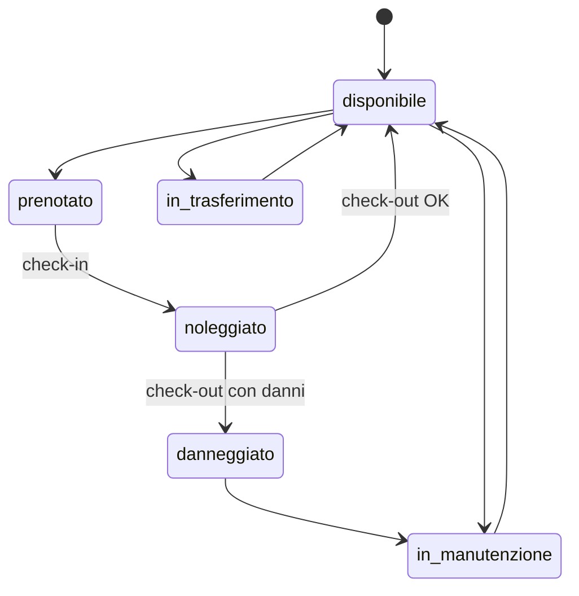
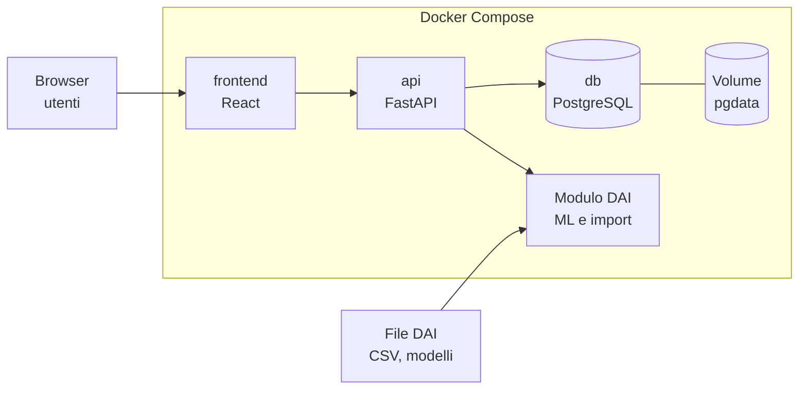
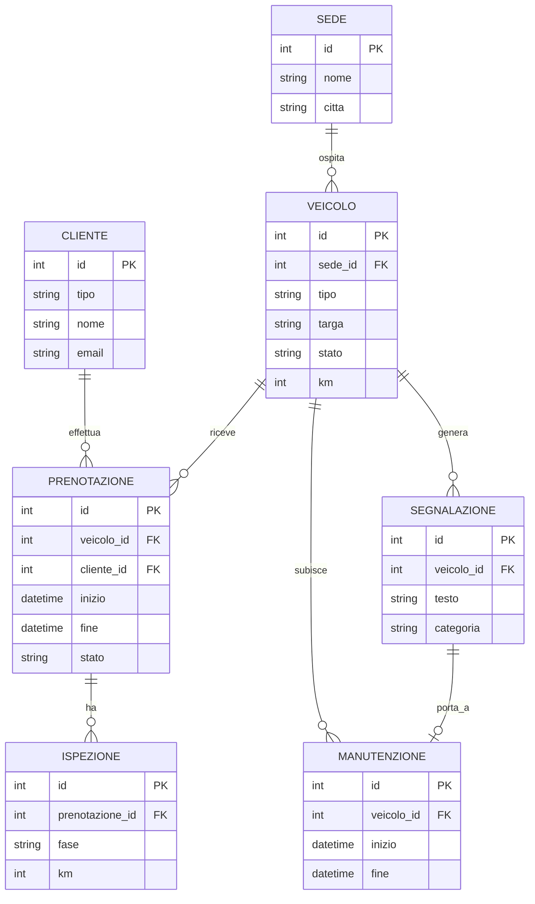
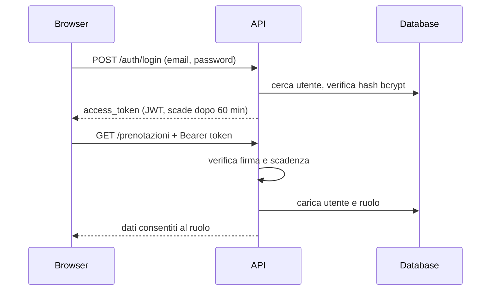
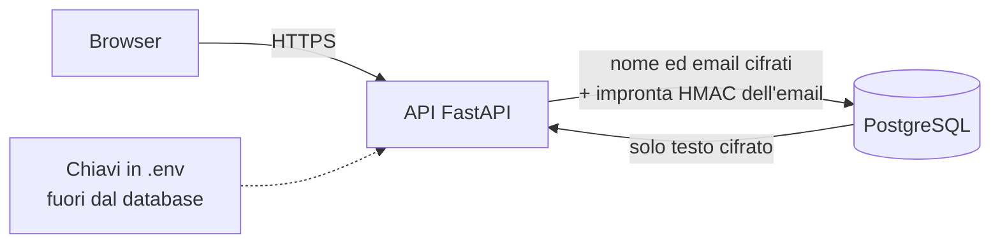

# Buby Rent – Documentazione tecnica (ruolo WSA)

Progetto Laboratorio Integrato · ITS Academy ICT Piemonte · Caso 3: Trasporti con noleggi

Applicazione web per prenotare e gestire il noleggio di auto, furgoni ed e-bike su più sedi, con un'area operatore per flotta, manutenzioni e trasferimenti. Usa i dati preparati dal team Data Analyst e AI Specialist (DAI) e ospita le loro componenti: previsione della domanda per sede e classificazione di danni e richieste di assistenza.

## Indice

1. [Scadenze](#1-scadenze)
2. [Come funziona un noleggio](#2-come-funziona-un-noleggio)
3. [Utenti e requisiti](#3-utenti-e-requisiti)
4. [Architettura](#4-architettura)
5. [Modello dati](#5-modello-dati)
6. [Logica di disponibilità](#6-logica-di-disponibilità)
7. [Autenticazione e autorizzazione](#7-autenticazione-e-autorizzazione)
8. [Protezione dei dati e GDPR](#8-protezione-dei-dati-e-gdpr)
9. [API REST](#9-api-rest)
10. [Struttura del repository](#10-struttura-del-repository)
11. [Installazione e avvio](#11-installazione-e-avvio)
12. [Stato attuale e da fare](#12-stato-attuale-e-da-fare)
13. [Piano di lavoro](#13-piano-di-lavoro)
14. [Consegne e valutazione](#14-consegne-e-valutazione)
15. [Rischi e attenzioni](#15-rischi-e-attenzioni)

---

## 1. Scadenze

| Data | Evento |
| --- | --- |
| 26 ottobre 2026 | Kickoff con il cliente: requisiti e formazione dei team |
| Seconda settimana | Definizione del contratto dati con il team DAI (sviluppo con dati mock) |
| 20 novembre 2026 | SAL 1: analisi, schema dati e contratto API. Schema e contratto vengono congelati |
| Settimane finali | Integrazione con i dati reali, test e rilascio |
| 18 dicembre 2026 | Presentazione finale al cliente |

Ogni settimana i team leader inviano al cliente un breve stato scritto.

## 2. Come funziona un noleggio

Un noleggio ruota attorno a un veicolo che passa da uno stato all'altro. Il backend deve modellare questo ciclo.

1. **Ricerca**: il cliente sceglie sede, date e tipo di veicolo e vede solo i mezzi liberi nel periodo.
2. **Prenotazione**: preventivo (tariffa, extra, cauzione) e conferma.
3. **Ritiro (check-in)**: verifica di documenti e patente, contratto, registrazione di km, carburante o batteria e foto dello stato del mezzo.
4. **Noleggio in corso**: eventuali proroghe o segnalazioni di problemi.
5. **Riconsegna (check-out)**: nuovo controllo, km percorsi, danni, ritardi e penali. Il confronto con le foto del ritiro stabilisce le responsabilità.
6. **Chiusura**: fatturazione e restituzione della cauzione.
7. **Post-noleggio**: pulizia e, se serve, manutenzione. Il veicolo torna disponibile solo quando è di nuovo idoneo.

**Stati del veicolo**: `disponibile`, `prenotato`, `noleggiato`, `in_manutenzione`, `danneggiato`, `in_trasferimento`. Il trasferimento tra sedi è un punto chiave del caso, perché la flotta non è sempre dove serve.

**Stati della prenotazione**: `richiesta`, `confermata`, `in_corso`, `conclusa`, `annullata`.



## 3. Utenti e requisiti

**Ruoli**

- **Cliente** (privato o azienda): cerca, prenota, consulta i propri noleggi, segnala un problema.
- **Operatore di sede**: gestisce flotta, check-in e check-out, manutenzioni e trasferimenti della propria sede.
- **Admin**: vede tutte le sedi, gestisce utenti, tariffe e sedi.

**Area cliente**

- Ricerca per sede, date e tipo di veicolo, con soli mezzi disponibili.
- Preventivo e conferma della prenotazione.
- Elenco dei propri noleggi, con annullamento e proroga.
- Segnalazione di guasti o danni in testo libero.

**Area operatore**

- Calendario e stato della flotta per sede.
- Check-in e check-out con km, carburante o batteria e foto.
- Gestione di segnalazioni, manutenzioni e fermi.
- Trasferimenti di veicoli tra sedi.
- Dashboard con utilizzo della flotta, previsione di domanda e giorni di fermo.

## 4. Architettura

Stack scelto: **Python con FastAPI**, **PostgreSQL**, **Docker Compose**. Il backend è unico e in un solo linguaggio, così condivide codice e librerie con le componenti Python del team DAI. k3s non è usato: risolve problemi di scala e alta disponibilità che il progetto non ha, e si può citare come evoluzione futura.



| Servizio | Tecnologia | Porta | Note |
| --- | --- | --- | --- |
| `frontend` | React/TanStack (Nitro su Node.js) | 3000 | Login, dashboard e gestione flotta; area cliente da completare |
| `api` | FastAPI | 8000 | Documentazione OpenAPI su `/docs` |
| `db` | PostgreSQL 16 | 5432 (interna) | Dati su volume persistente `pgdata` |
| Modulo DAI | Python, dentro `api` o servizio separato | – | Previsioni e classificazione; i file di output del team DAI vengono importati |

## 5. Modello dati



Implementate nel codice: `Sede`, `Veicolo`, `Cliente` (nome ed email cifrati, `email_idx`, `anonimizzato_il`), `Prenotazione`, `Utente` (email cifrata, `email_idx`, password_hash, ruolo, collegamento opzionale a `Cliente` e a `Sede`, `privacy_versione`, `privacy_accettata_il`), `Ispezione`, `Segnalazione`, `Manutenzione` e `Trasferimento`. Utente e i campi di protezione dati non sono nel diagramma per semplicità; la cifratura è descritta nella sezione 8. `Tariffa`, `Contratto` e le tabelle DAI non sono ancora implementate; i relativi campi si decidono nel contratto dati.

## 6. Logica di disponibilità

Un veicolo è prenotabile in un periodo solo se:

- il suo stato non è `in_manutenzione`, `danneggiato` o `in_trasferimento`;
- non ha prenotazioni attive (`richiesta`, `confermata`, `in_corso`) che si sovrappongono al periodo.

Due periodi A e B si sovrappongono quando `inizio_A < fine_B` e `fine_A > inizio_B`.

Per evitare doppie prenotazioni simultanee, `POST /prenotazioni` blocca la riga del veicolo (`SELECT ... FOR UPDATE`) all'interno della transazione: due richieste sullo stesso mezzo si accodano e la seconda trova la sovrapposizione e riceve `409`.

La creazione di una manutenzione attiva o di un trasferimento imposta lo stato bloccante del veicolo. La disponibilità temporale basata su intervalli di manutenzione e trasferimento resta da integrare nel controllo condiviso.

## 7. Autenticazione e autorizzazione

L'API usa token **JWT** (JSON Web Token) firmati con HS256. Il cliente fa login una volta, riceve un token e lo invia in ogni richiesta protetta nell'header `Authorization: Bearer <token>`.



**Password**: salvate solo come hash bcrypt, mai in chiaro. Lunghezza minima 8 caratteri, massima 72 (limite di bcrypt).

**Token**: contiene `sub` (id utente), `ruolo`, `iat` e `exp`. Viene rifiutato con `401` se scaduto, alterato, firmato con un'altra chiave o malformato. Durata configurabile con `ACCESS_TOKEN_MINUTES` (default 60).

**Ruolo**: il ruolo che conta viene letto dal database a ogni richiesta, non dal token. Se un utente cambia ruolo o viene eliminato, l'effetto è immediato.

**Login**: le credenziali errate e l'email inesistente danno la stessa risposta `401`, e il tempo di risposta è simile, per non rivelare quali email sono registrate.

**Registrazione**: `POST /auth/register` crea sempre un utente con ruolo `cliente` (e la relativa anagrafica `Cliente`). Richiede `accetta_privacy: true`: versione dell'informativa e data di accettazione vengono salvate. Operatori e admin non si auto-registrano: vengono creati dall'amministratore, oggi dal seed con le password prese da variabili d'ambiente.

**Permessi per ruolo**

| Azione | Pubblico | Cliente | Operatore | Admin |
| --- | --- | --- | --- | --- |
| Cercare veicoli disponibili | sì | sì | sì | sì |
| Registrarsi, fare login | sì | sì | sì | sì |
| Creare una prenotazione | no | solo per sé | per qualsiasi cliente | per qualsiasi cliente |
| Vedere le prenotazioni | no | solo le proprie | tutte | tutte |
| Cambiare lo stato di un veicolo | no | no | solo della propria sede | tutti |

**Nel codice**: `utente_corrente` (in `deps.py`) valida il token e restituisce l'utente; `richiedi_ruoli("operatore", "admin")` protegge un endpoint per ruolo. Esempio:

```python
@router.patch("/{veicolo_id}/stato")
def cambia_stato(..., utente: Utente = Depends(richiedi_ruoli("operatore", "admin"))):
    ...
```

Se `SUPABASE_URL` è configurato, l'API accetta access token Supabase firmati ES256/RS256 e ne verifica la firma con il JWKS del progetto, oltre a issuer, audience e ruolo `authenticated`. Il claim `sub` viene collegato tramite la tabella `identita_supabase` a `Utente`; i ruoli e la sede restano sempre quelli del database. Il collegamento iniziale (`POST /auth/supabase/provision`) verifica l'identità e l'email confermata presso Supabase Auth. Per i nuovi clienti richiede nome e accettazione privacy. In questa modalità `/auth/login` e `/auth/register` locali sono disattivati. Le variabili necessarie sono `SUPABASE_URL` e `SUPABASE_PUBLISHABLE_KEY`; la chiave publishable non è una service-role key.

**Configurazione** (file `.env`):

| Variabile | Uso |
| --- | --- |
| `SECRET_KEY` | Chiave di firma dei token. Genera: `python -c "import secrets; print(secrets.token_hex(32))"` |
| `ACCESS_TOKEN_MINUTES` | Durata del token (default 60) |
| `ENVIRONMENT` | `development` o `production`. In `production` le chiavi di sviluppo bloccano l'avvio |
| `CORS_ORIGINS` | Origini browser autorizzate, separate da virgola; inserire l'URL esatto del preview Lovable, senza wildcard |
| `VITE_API_URL` | URL API inserito nel bundle frontend; Compose usa `http://localhost:8000` |
| `VITE_SUPABASE_URL`, `VITE_SUPABASE_PUBLISHABLE_KEY` | Configurazione browser Supabase, pubblica; Compose la deriva dalle variabili Supabase backend |
| `ENCRYPTION_KEYS` | Chiavi di cifratura dei dati personali (vedi sezione 8) |
| `BLIND_INDEX_KEY` | Chiave dell'impronta per cercare l'email (vedi sezione 8) |
| `SUPABASE_URL` | URL del progetto; se valorizzato abilita i JWT Supabase e disattiva login/registrazione locali |
| `SUPABASE_PUBLISHABLE_KEY` | Chiave publishable, usata dall'API durante il collegamento iniziale account |
| `ADMIN_EMAIL`, `ADMIN_PASSWORD` | Admin di prova creato al primo avvio |
| `OPERATORE_PASSWORD` | Password dell'operatore di prova (`operatore@buby.it`, sede 1) |
| `CEO_EMAIL`, `CEO_PASSWORD` | Account CEO di prova globale in sola lettura |
| `SMTP_HOST`, `SMTP_PORT` | Server SMTP usato dal worker email |
| `MAIL_FROM` | Mittente delle email applicative |
| `POLL_SECONDS` | Intervallo di polling del worker |

**Limiti attuali**: l'autenticazione locale non ha refresh token (alla scadenza l'utente rifà il login), logout lato server o blocco dopo tentativi falliti. Con Supabase il client browser rinnova la sessione in memoria; il JWT non viene salvato in `localStorage`.

## 8. Protezione dei dati e GDPR

> Questa sezione descrive le misure tecniche implementate e una checklist di lavoro. Non è consulenza legale: basi giuridiche, informativa, periodi di conservazione e ruoli (titolare, responsabile) vanno concordati con il referente privacy di Buby Group. I dati del laboratorio sono sintetici, quindi il GDPR non si applica al dataset; restano personali le email vere che un utente inserisce registrandosi alla demo. Le misure qui sotto sono implementate perché l'applicazione sia pronta per dati reali, e il documento di progetto chiede di curare anonimizzazione e GDPR. Le voci puramente organizzative della checklist 8.4 (registro dei trattamenti, procedura per le violazioni, informativa) sono indicate come necessarie in produzione, non vanno prodotte per la demo.

### 8.1 Cosa è protetto e come

| Dato | Misura | Note |
| --- | --- | --- |
| Password | Hash bcrypt | Non è cifratura: non si può risalire alla password |
| Nome ed email del cliente | Cifrati nel database (Fernet: AES-128-CBC con firma HMAC-SHA256) | Cifratura a livello applicativo: chi legge il database o un backup vede solo testo cifrato |
| Email di login (utenti) | Cifrata, più impronta HMAC-SHA256 | L'impronta (blind index) permette login e controllo dei duplicati senza salvare l'email in chiaro |
| Dati in transito | HTTPS | Da configurare con un reverse proxy; su HTTP i dati viaggiano in chiaro |
| Disco, volume e backup del database | Cifratura a livello di infrastruttura | Fuori dal codice: da attivare dove si fa il deploy |
| Targa, km, date e stato delle prenotazioni | Non cifrati | Servono alle query (per esempio le sovrapposizioni). Restano personali solo tramite `cliente_id`, che senza nome ed email non identifica nessuno da solo |



**Come funziona nel codice**

- `crypto.py`: cifra e decifra con Fernet e calcola l'impronta HMAC.
- `encrypted_types.py`: il tipo di colonna `StringaCifrata` cifra in scrittura e decifra in lettura, quindi il resto del codice usa `cliente.nome` e `cliente.email` come testo normale.
- `models.py`: ogni volta che si assegna l'email, l'impronta `email_idx` viene ricalcolata in automatico. L'unicità e le ricerche usano `email_idx`, non l'email.

**Limiti della cifratura**

- Protegge da fughe del database e dei backup, non da un'applicazione compromessa: l'API possiede le chiavi.
- Non sostituisce il controllo degli accessi (sezione 7).
- I campi cifrati non si possono cercare per parte di testo né ordinare: l'email si trova solo con corrispondenza esatta, il nome non si cerca nel database.
- Se si perdono le chiavi, i dati sono irrecuperabili.

### 8.2 Gestione delle chiavi

| Chiave | Uso | Se viene esposta |
| --- | --- | --- |
| `ENCRYPTION_KEYS` | Cifra e decifra nomi ed email | Chi ha anche il database legge i dati personali |
| `BLIND_INDEX_KEY` | Impronta delle email | Si possono verificare elenchi di email candidate |
| `SECRET_KEY` | Firma dei token JWT | Si possono falsificare i token |

Regole:

- Le tre chiavi sono diverse tra loro, generate con i comandi in `.env.example`, e stanno solo in `.env` o in un gestore di segreti, mai nel repository né nei log.
- Va fatto un **backup separato** delle chiavi, non insieme al backup del database.
- Con `ENVIRONMENT=production` l'API non parte se usa le chiavi di sviluppo.
- In un deploy reale conviene un gestore di segreti (per esempio quello del cloud scelto) al posto del file `.env`.
- Cambiare `BLIND_INDEX_KEY` invalida tutte le impronte: dopo il cambio vanno ricalcolate, altrimenti nessuno riesce più a fare login. Va quindi scelta una volta e non ruotata alla leggera.

**Rotazione di `ENCRYPTION_KEYS`** (la prima chiave cifra, tutte decifrano):

1. Genera una nuova chiave Fernet.
2. Mettila prima delle altre: `ENCRYPTION_KEYS=NUOVA,VECCHIA`, poi riavvia l'API.
3. Esegui `docker compose exec api python -m app.rotate_keys`: ricifra tutte le righe con la chiave nuova.
4. Togli la chiave vecchia da `ENCRYPTION_KEYS`.

### 8.3 Diritti degli interessati

| Diritto | Articolo GDPR | Endpoint | Comportamento |
| --- | --- | --- | --- |
| Accesso e portabilità | 15 e 20 | `GET /auth/me/dati` | Tutti i dati dell'utente in JSON: account, anagrafica, prenotazioni, versione dell'informativa accettata |
| Rettifica | 16 | `PATCH /auth/me` | Il cliente corregge il proprio nome |
| Cancellazione | 17 | `DELETE /auth/me` | Elimina l'account e anonimizza l'anagrafica; vedi sotto |

**Come funziona la cancellazione**: l'account viene eliminato, il nome diventa "Utente eliminato" e l'email diventa un valore anonimo (`eliminato-<id>@anonimo.invalid`). Le prenotazioni restano, ormai senza dati identificativi, perché contratti e fatture vanno conservati per obblighi di legge: l'art. 17, par. 3, lett. b) esclude la cancellazione quando il trattamento serve a adempiere un obbligo legale. Per le scritture contabili il periodo tipico in Italia è di 10 anni, da confermare con il cliente. Se il cliente ha prenotazioni attive la richiesta è rifiutata (`409`). Dopo la cancellazione l'email si può registrare di nuovo.

**Consenso e informativa**: per un noleggio la base giuridica del trattamento è di norma l'esecuzione del contratto, non il consenso. La registrazione richiede comunque di accettare l'informativa privacy e salva `privacy_versione` e `privacy_accettata_il`, come prova di quale testo l'utente ha visto. Il testo dell'informativa (art. 13) va fornito dal cliente e mostrato nel frontend.

### 8.4 Checklist di conformità

| Principio o obbligo | Stato | Cosa resta da fare |
| --- | --- | --- |
| Minimizzazione (art. 5): raccogliere solo il necessario | Fatto per ora | Raccolti nome, email e tipo cliente. Per patente e documenti, valutare se serve davvero conservarli dopo il ritiro |
| Cifratura e pseudonimizzazione (art. 32) | In parte | Nome ed email cifrati. Da aggiungere ai nuovi campi personali (telefono, patente, testo delle segnalazioni) quando si implementano |
| Diritti degli interessati (artt. 15-17, 20) | Fatto | Mancano limitazione e opposizione (artt. 18 e 21), da gestire anche in via organizzativa |
| Limitazione della conservazione (art. 5) | Da fare | Definire i periodi con il cliente e prevedere una cancellazione o anonimizzazione automatica |
| Privacy by design e by default (art. 25) | In parte | Ruoli e permessi minimi già presenti; verificare ogni nuovo endpoint |
| Informativa privacy (art. 13) | Da fare | Testo dal cliente, da mostrare in registrazione |
| Registro dei trattamenti (art. 30) | Da fare | Documento a cura del titolare, con il supporto del team |
| Responsabili e riservatezza (art. 28, NDA) | Da fare | Richiesto dal documento di progetto: accordo con il cliente prima di ricevere dati reali |
| Violazioni dei dati (artt. 33-34) | Da fare | Scrivere una procedura: la notifica al Garante va fatta entro 72 ore dalla scoperta, se c'è rischio per gli interessati |
| Log degli accessi ai dati personali | Da fare | Registrare chi legge o esporta dati personali, senza scrivere i dati nei log |
| Dati verso il team DAI | Da fare | Dare loro `cliente_id` al posto di nome ed email; il testo libero (segnalazioni, email) va privato dei dati personali prima di passarlo, perché cifrato non è leggibile da modelli e analisi |
| Test | Fatto | Usare solo dati fittizi in sviluppo e nella demo |

**Riferimenti**

- [Art. 32 GDPR – Sicurezza del trattamento](https://gdpr-text.com/it/read/article-32/): cita la pseudonimizzazione e la cifratura tra le misure da considerare.
- [Le misure di sicurezza nel GDPR (Cybersecurity360)](https://www.cybersecurity360.it/legal/privacy-dati-personali/le-misure-di-sicurezza-nel-gdpr-quali-sono-come-applicarle-costi-di-attuazione/): il GDPR non impone misure specifiche, ma richiede misure adeguate al rischio; difficile giustificare l'assenza di quelle di base.

### 8.5 Effetti sul database e sui dati esistenti

- Lo schema è cambiato (colonne cifrate, `email_idx`, campi privacy): non essendoci ancora migrazioni, vanno ricreate le tabelle con `docker compose down -v` e poi `docker compose up --build`. I dati di prova si ricaricano da soli.
- Un database creato con una chiave non si legge con un'altra: tieni stabile `ENCRYPTION_KEYS` tra un avvio e l'altro.

## 9. API REST

**Implementati**

| Metodo | Endpoint | Accesso | Descrizione |
| --- | --- | --- | --- |
| GET | `/health` | pubblico | Stato del servizio |
| POST | `/auth/register` | pubblico | Registra un cliente. Richiede `accetta_privacy: true`. `409` se l'email esiste, `422` se i dati non sono validi |
| POST | `/auth/login` | pubblico | Form con `username` (email) e `password`. Restituisce `access_token`. `401` se errati |
| POST | `/auth/supabase/provision` | JWT Supabase | Collega un'identità con email verificata all'utente locale; un nuovo cliente deve accettare l'informativa |
| GET | `/auth/me` | autenticato | Profilo dell'utente corrente |
| PATCH | `/auth/me` | cliente | Rettifica il proprio nome (art. 16 GDPR) |
| GET | `/auth/me/dati` | autenticato | Esporta tutti i propri dati personali in JSON (artt. 15 e 20 GDPR) |
| DELETE | `/auth/me` | cliente | Cancella l'account e anonimizza l'anagrafica (art. 17 GDPR). `409` con prenotazioni attive |
| GET | `/veicoli/disponibili?sede_id=&da=&a=&tipo=` | pubblico | Veicoli liberi nel periodo. `da` e `a` in formato ISO 8601 |
| PATCH | `/veicoli/{id}/stato` | operatore, admin | Cambia lo stato. L'operatore solo nella propria sede. `403`, `404`, `422` |
| POST | `/prenotazioni` | autenticato | Crea una prenotazione. Errori: `404` veicolo o cliente, `409` non noleggiabile o già prenotato, `422` date non valide |
| GET | `/prenotazioni?cliente_id=` | autenticato | Il cliente vede le proprie, operatore e admin tutte. Dalla più recente |
| GET | `/dashboard/flotta?sede_id=&stato_veicolo=&stato_prenotazione=` | operatore, admin | Riepilogo e lista flotta con filtri; l'operatore è limitato alla propria sede, l'admin deve indicare la sede |
| GET | `/clienti` | operatore, admin | Elenco degli ID cliente per creare prenotazioni per conto terzi; non restituisce nome o email |
| POST | `/prenotazioni/{id}/checkin` | operatore, admin | Registra ispezione di ritiro (km, carburante/batteria, URL foto e note), avvia il noleggio |
| POST | `/prenotazioni/{id}/checkout` | operatore, admin | Registra ispezione di riconsegna e chiude il noleggio; se `danni_rilevati` è true, crea una segnalazione e blocca il veicolo |
| GET | `/prenotazioni/{id}/ispezioni` | operatore, admin | Elenca le ispezioni; l'operatore deve appartenere alla sede del veicolo |
| GET, POST | `/veicoli/{id}/segnalazioni` | operatore, admin; creazione anche cliente autenticato | Consultazione per la sede o inserimento di una segnalazione |
| GET, POST | `/veicoli/{id}/manutenzioni` | operatore, admin | Consulta o registra manutenzioni e aggiorna lo stato del veicolo |
| GET, POST | `/veicoli/{id}/trasferimenti` | operatore, admin | Consulta o programma un trasferimento tra sedi |
| PATCH | `/trasferimenti/{id}/stato?stato=` | operatore, admin | Aggiorna il trasferimento; al completamento sposta il veicolo alla sede di destinazione |

Tutti gli endpoint protetti rispondono `401` senza token valido e `403` se il ruolo non basta.

Le richieste HTTP dell'API vengono registrate in `buby-rent/logs/api.log` con ID richiesta, metodo, percorso senza query string, status HTTP, durata e tipo dell'eventuale eccezione non gestita. I log ruotano a 10 MB e mantengono cinque file precedenti. Body, query string, header di autenticazione e messaggi delle eccezioni non vengono registrati. L'header `X-Request-ID` permette di correlare una risposta con la riga di log; questo log tecnico non sostituisce il previsto audit nominativo degli accessi ai dati personali.

Esempio di login e prenotazione:

```bash
curl -X POST http://localhost:8000/auth/login \
  -d "username=anna@example.com&password=password123"
# {"access_token": "eyJ...", "token_type": "bearer"}

curl -X POST http://localhost:8000/prenotazioni \
  -H "Authorization: Bearer eyJ..." \
  -H "Content-Type: application/json" \
  -d '{"veicolo_id": 1, "inizio": "2026-11-10T09:00:00", "fine": "2026-11-12T09:00:00"}'
```

Per un cliente, `cliente_id` si ricava dal token e non va inviato. Operatori e admin lo devono indicare.

Con Supabase Auth abilitato, ottenere prima il token da Supabase e inviarlo come `Authorization: Bearer <access_token>` a `POST /auth/supabase/provision`. Admin/operatori devono avere un account Supabase con email verificata uguale a quella del rispettivo utente applicativo; i nuovi clienti inviano `{"nome":"...","tipo":"privato","accetta_privacy":true}`. Il frontend React supporta il login Supabase e il collegamento iniziale degli account esistenti; il flusso di registrazione dei nuovi clienti resta da implementare.

**Non ancora implementati**

- Cliente: `PATCH /prenotazioni/{id}` (annulla, proroga)
- Integrazione con il team DAI: `GET /kpi/utilizzo-flotta`, `GET /previsioni/domanda?sede=&da=&a=`, `GET /segnalazioni/{id}/classificazione`, `POST /import/previsioni`, `POST /import/classificazioni`

Schema esatto, risposte di esempio e codici di errore vanno nel contratto dati, che si congela il 20 novembre.

## 10. Struttura del repository

```
buby-rent/
├── docker-compose.yml
├── .env.example
├── README.md
├── api/
│   ├── Dockerfile
│   ├── requirements.txt
│   └── app/
│       ├── main.py            avvio, CORS, router
│       ├── config.py          configurazione da variabili d'ambiente
│       ├── database.py        engine e sessioni SQLAlchemy
│       ├── models.py          tabelle e costanti degli stati
│       ├── schemas.py         modelli Pydantic di richiesta e risposta
│       ├── availability.py    logica di disponibilità
│       ├── security.py        hash password (bcrypt) e token JWT
│       ├── crypto.py          cifratura Fernet e impronta HMAC
│       ├── encrypted_types.py colonna SQLAlchemy cifrata
│       ├── rotate_keys.py     rotazione delle chiavi di cifratura
│       ├── deps.py            utente corrente e controllo dei ruoli
│       ├── seed.py
│       ├── operazioni.py      dashboard flotta, ispezioni, segnalazioni e gestione operativa            dati mock
│       └── routers/
│           ├── auth.py
│           ├── veicoli.py
│           └── prenotazioni.py
└── frontend/
    ├── Dockerfile             build frontend React e runtime Node/Nitro
    └── src/                   frontend React/TanStack
```

## 11. Installazione e avvio

Requisiti: Docker e Docker Compose.

```bash
cd buby-rent
cp -n .env.example ../.env
docker compose --env-file ../.env up --build
```

- API: http://localhost:8000 (documentazione interattiva su `/docs`)
- Frontend: http://localhost:3000
- Health check API: http://localhost:8000/health

All'avvio le tabelle vengono create e vengono caricati dati mock; il seed crea un
operatore per ogni sede oltre agli account admin e CEO.

| Ruolo | Email | Password |
| --- | --- | --- |
| admin | `admin@buby.it` | `admin12345` |
| operatore (sede 1) | `operatore@buby.it` | `operatore12345` |
| operatore Porta Susa | `operatore.porta-susa@buby.it` | `operatore12345` |
| operatore Lingotto | `operatore.lingotto@buby.it` | `operatore12345` |
| operatore Moncalieri | `operatore.moncalieri@buby.it` | `operatore12345` |
| operatore Rivoli | `operatore.rivoli@buby.it` | `operatore12345` |
| operatore Venaria Reale | `operatore.venaria-reale@buby.it` | `operatore12345` |
| CEO (tutte le sedi, sola lettura) | `buby@buby.it` | `buby12345` |

Nel file `.env` imposta `POSTGRES_PASSWORD`, `SECRET_KEY`, `ENCRYPTION_KEYS`, `BLIND_INDEX_KEY` (comandi per generarle in `.env.example`) e cambia le password di prova. Non committare mai `.env`. Se `ENCRYPTION_KEYS` e `BLIND_INDEX_KEY` restano vuote l'API usa chiavi di sviluppo e lo segnala nei log. Se aggiorni da una versione precedente, ricrea il database con `docker compose down -v`. Su `/docs` il pulsante Authorize permette di provare gli endpoint protetti dopo il login.

Per fermare i servizi: `docker compose down`. Per cancellare anche il database: `docker compose down -v`.

## 12. Stato attuale e da fare

**Fatto**

- Scheletro del repository con Docker Compose, FastAPI e PostgreSQL
- Modelli `Sede`, `Veicolo`, `Cliente`, `Prenotazione`
- Ricerca dei veicoli disponibili e creazione di prenotazioni con controllo delle sovrapposizioni
- Ispezioni di ritiro/riconsegna, check-in/check-out, segnalazioni, manutenzioni e trasferimenti
- Dashboard operativa React con conteggi, flotta e filtri per sede
- Autenticazione JWT: registrazione, login, profilo, ruoli cliente, operatore e admin, permessi per endpoint
- Cambio di stato dei veicoli riservato a operatori e admin
- Cifratura di nome ed email, con impronta HMAC per login e duplicati, e rotazione delle chiavi
- Diritti GDPR di accesso, portabilità, rettifica e cancellazione, e registrazione dell'accettazione dell'informativa
- Dati mock

**Da fare**

- [ ] Gestione utenti da parte dell'admin (creare operatori, cambiare ruoli)
- [ ] Conservazione dei dati: periodi di retention e cancellazione automatica
- [ ] Log degli accessi ai dati personali
- [ ] Cifratura dei futuri campi personali (telefono, patente, testo delle segnalazioni)
- [ ] Pseudonimizzazione dei dati consegnati al team DAI
- [ ] Registro dei trattamenti, informativa e procedura per le violazioni (con il cliente)
- [ ] Refresh token, blocco dopo tentativi di login falliti
- [x] Verifica backend dei JWT Supabase e collegamento dell'identità all'utente applicativo
- [x] Login Supabase nel frontend React e collegamento iniziale al backend
- [ ] Verifica temporale di manutenzioni e trasferimenti nella disponibilità
- [ ] Upload e conservazione sicura delle foto delle ispezioni (ora si registra solo un URL)
- [ ] Import dei dati del team DAI secondo il contratto dati
- [ ] Migrazioni con Alembic (oggi le tabelle sono create all'avvio)
- [x] Test automatici iniziali: auth, autorizzazioni, prenotazioni/sovrapposizioni, dashboard, check-in/check-out e privacy dei log
- [ ] Ampliare la copertura automatica, in particolare sulla disponibilità
- [ ] Completare area cliente e flussi operatore nel frontend React

## 13. Piano di lavoro

1. **Settimane 1-2**: requisiti, architettura, bozza di schema e contratto API, mock dei dati.
2. **Fino al 20 novembre**: backend base (auth, sedi, veicoli, prenotazioni), interfaccia cliente con dati mock, preparazione del SAL 1.
3. **Dopo il SAL 1**: area operatore, check-in e check-out, manutenzioni, trasferimenti, dashboard.
4. **Settimane finali**: import dei dati reali, integrazione di previsioni e classificazione, test, correzioni.
5. **Entro il 18 dicembre**: documentazione, istruzioni di installazione, demo.

## 14. Consegne e valutazione

**Consegne WSA**

- Applicazione funzionante con database, API e interfaccia
- Documentazione tecnica (architettura e API)
- Repository del codice con istruzioni di installazione
- Demo finale davanti all'azienda

**Criteri**: qualità dell'architettura e del codice, funzionamento e usabilità dell'applicazione, integrazione con i dati reali, collaborazione tra i team, rispetto delle scadenze, chiarezza della documentazione, efficacia della demo.

## 15. Rischi e attenzioni

- **Contratto dati cambiato dopo il congelamento**: concordare lo schema per tempo e versionarlo.
- **Dati reali diversi dai mock**: validare i campi in ingresso e prevedere valori mancanti.
- **Doppie prenotazioni**: gestire la concorrenza con transazioni (già fatto per le prenotazioni).
- **Dati personali di clienti ed email**: rispetto di GDPR, anonimizzazione e NDA, come richiesto dal cliente. Misure e checklist alla sezione 8.
- **Perdita delle chiavi di cifratura**: i dati diventano illeggibili. Fare un backup delle chiavi separato da quello del database.
- **Testo libero con dati personali** (segnalazioni, email): non va dato al team DAI senza averlo prima ripulito.
- **Foto delle ispezioni**: decidere dove salvarle (file system o storage) e con quali limiti di dimensione.
- **Segreti**: le credenziali e la `SECRET_KEY` stanno solo in `.env`, mai nel repository. Con la chiave di sviluppo i token sono falsificabili: in consegna usa sempre una chiave vera.
- **Password di prova**: `admin12345` e `operatore12345` sono solo per lo sviluppo e vanno cambiate prima della demo.
- **HTTPS**: i token viaggiano in chiaro su HTTP. Per un uso reale serve HTTPS (reverse proxy).
