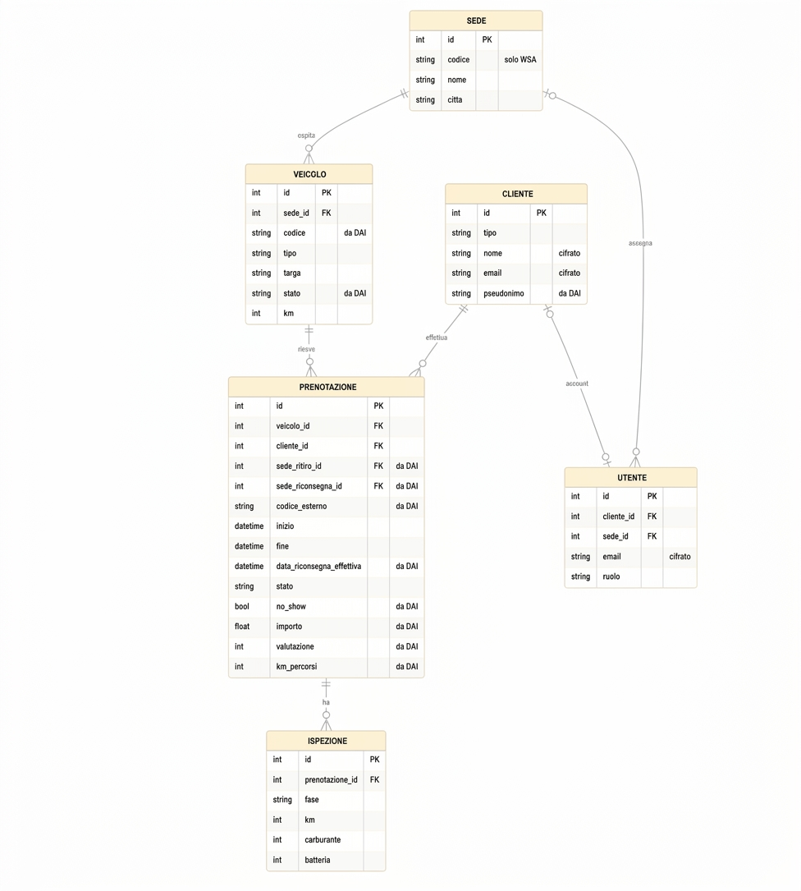
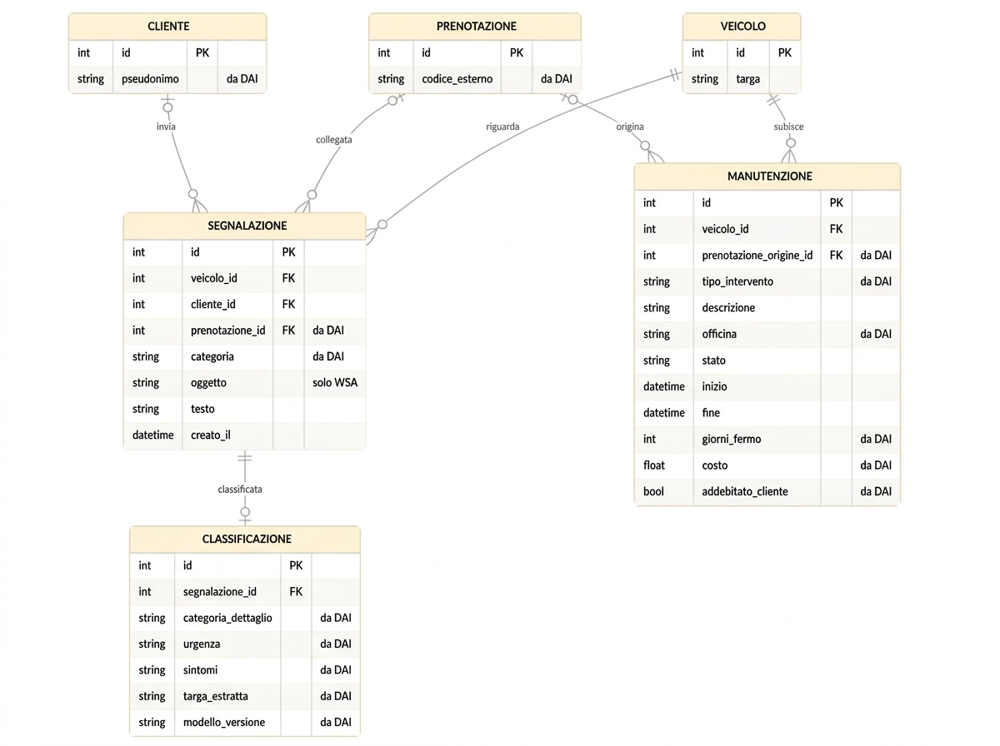
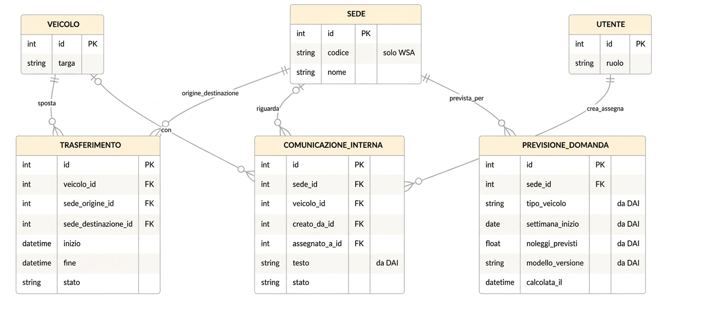

# 🚗 Buby Rent — Piano di Integrazione Dati e Architettura Database (DAI / WSA)

Questo documento raccoglie le specifiche del database relazionale (diagrammi ERD) e il piano d'azione per l'esportazione, la pulizia e la generazione dei file CSV destinati all'alimentazione del sistema (**DAI**).

---

## 📋 Piano d'azione sui file CSV

La tabella seguente descrive nel dettaglio le attività da svolgere sui file sorgente, le colonne richieste, l'origine dei dati esistenti e l'ordine di priorità.

| File target | Azione | Colonne da avere | Dove ce l'hanno già / Note | Priorità |
| :--- | :--- | :--- | :--- | :--- |
| **`prenotazioni.csv`** | Aggiungere colonne | `id_noleggio`, `sede_ritiro`, `sede_riconsegna`, `no_show`, `importo_totale_eur`, `valutazione_cliente`, `data_riconsegna_effettiva`, `km_percorsi`, `cliente_id` | Tutte già presenti in `noleggi_tutti_pulito.csv`: basta esportarle. | 🔴 **Alta** |
| **`manutenzioni.csv`** | File nuovo | `id_intervento`, `targa`, `data_ingresso`, `data_uscita`, `giorni_fermo`, `tipo_intervento`, `descrizione_breve`, `officina`, `costo_eur`, `addebitato_cliente`, `id_noleggio_origine`, `stato_intervento` | Disponibili in `manutenzioni_tutti_pulito.csv`, tranne `targa` da aggiungere tramite join (attualmente hanno solo `id_veicolo`). | 🔴 **Alta** |
| **`segnalazioni.csv`** | Aggiungere una colonna | `id_noleggio_corretto` | Da recuperare da `comunicazioni_tutti_pulito.csv`. | 🔴 **Alta** |
| **`veicoli.csv`** | Aggiungere una colonna e correggere | `id_veicolo`, `stato` (realistico) | `id_veicolo` è in `files/flotta.csv`. Lo stato realistico si ricava dagli interventi di manutenzione in corso (oggi 9). | 🟡 **Media** |
| **`comunicazioni_interne.csv`** | File nuovo *(da confermare)* | `id_comunicazione`, `data_ora`, `mittente_tipo`, `testo_clean`, `id_noleggio_corretto` | Estrarre da `comunicazioni_tutti_pulito.csv` filtrando le righe di tipo *tecnico* e *operatore* (737 righe). | 🟡 **Media** |
| **`classificazioni.csv`** | File nuovo *(più avanti)* | `id_comunicazione`, `categoria_dettaglio`, `urgenza`, `sintesi`, `targa_estratta`, `modello_versione` | Da produrre successivamente con il modello classificatore (NLP/IA). | 🟡 **Media** |
| **`previsioni.csv`** | File nuovo *(più avanti)* | `sede`, `tipo_veicolo`, `settimana_inizio`, `noleggi_previsti`, `modello_versione` | Da produrre successivamente con il modello di previsione della domanda. | 🟡 **Media** |

---

## ✅ Checklist delle attività

### Priorità Alta (Da fare subito)
* [ ] **`prenotazioni.csv`** : Esportare le 9 colonne mancanti da `noleggi_tutti_pulito.csv`.
* [ ] **`manutenzioni.csv`** : Creare il nuovo file da `manutenzioni_tutti_pulito.csv` associando la `targa` tramite `id_veicolo`.
* [ ] **`segnalazioni.csv`** : Aggiungere la colonna `id_noleggio_corretto` da `comunicazioni_tutti_pulito.csv`.

### Priorità Media (Pulizia & Consolidamento)
* [ ] **`veicoli.csv`** : Aggiungere `id_veicolo` (da `files/flotta.csv`) e aggiornare il campo `stato` in base ai 9 interventi di manutenzione in corso.
* [ ] **`comunicazioni_interne.csv`** : *(In attesa di conferma)* Filtrare le 737 comunicazioni interne (`tecnico` / `operatore`) da `comunicazioni_tutti_pulito.csv`.

### Passaggi successivi (Modelli IA / Predittivi)
* [ ] **`classificazioni.csv`** : Eseguire il classificatore automatico sulle segnalazioni.
* [ ] **`previsioni.csv`** : Eseguire il modello di previsione della domanda per sede e tipologia di veicolo.

---

## 🗄️ Diagrammi del Database (ERD)

Il database si articola attorno a tre aree funzionali alimentate dai file **DAI** e dall'applicazione **WSA**.

> **Legenda delle annotazioni dello schema:**
> * `da DAI` : Dati importati o arricchiti dalle pipeline/file CSV DAI.
> * `solo WSA` : Campi specifici dell'applicazione Web / sistema interno (es. `codice` in `SEDE`, `oggetto` in `SEGNALAZIONE`).
> * `cifrato` : Dati personali sensibili crittografati (GDPR).

### 1. Gestione Sedi, Veicoli, Clienti e Prenotazioni
Entità principali: `SEDE`, `VEICOLO`, `CLIENTE`, `UTENTE`, `PRENOTAZIONE`, `ISPEZIONE`.

### 2. Segnalazioni, Classificazione e Manutenzione
Entità principali: `SEGNALAZIONE`, `CLASSIFICAZIONE`, `MANUTENZIONE`.

### 3. Logistica, Comunicazioni Interne e Previsioni
Entità principali: `TRASFERIMENTO`, `COMUNICAZIONE_INTERNA`, `PREVISIONE_DOMANDA`.

### 4. Diagramma ERD completo e finale del progetto

